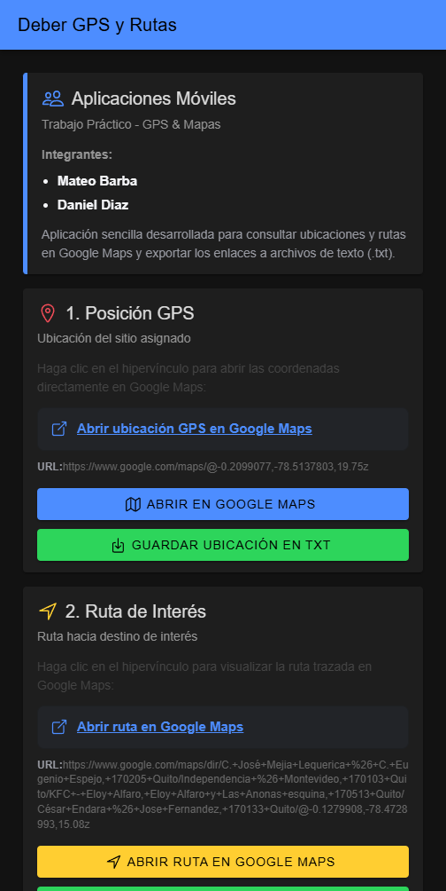
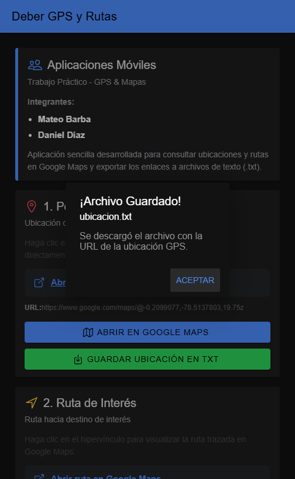
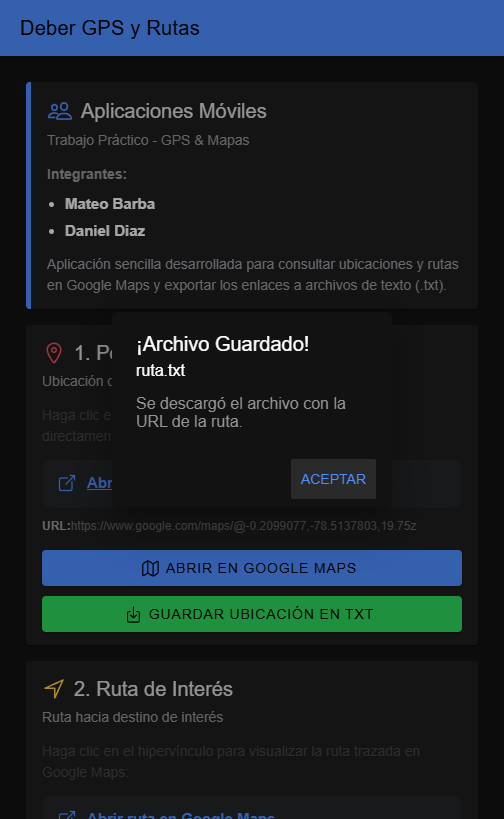

# 📍 DeberGPS — Ionic + Angular + Capacitor

Aplicación móvil educativa desarrollada con **Ionic**, **Angular** y **Capacitor** para la materia de **Aplicaciones Móviles** (ESFOT - EPN). Permite interactuar con coordenadas GPS y rutas en Google Maps, además de exportar la información a archivos de texto locales (`.txt`).

> **Nota:** Esta aplicación fue realizada como práctica de clase para el manejo de hipervínculos externos, interacción con servicios de mapas en línea y generación/descarga de archivos de texto en dispositivos móviles y navegadores.

---

## 🧰 Tecnologías

| Tecnología | Versión declarada | Uso |
|---|---|---|
| Ionic Angular | ^9.0.0 | Componentes e interfaz móvil |
| Angular | ^22.0.0 | Estructura de la aplicación (Standalone Components) |
| Capacitor Core / App | ^8.0.0 | Integración con plataformas nativas |
| Ionicons | ^8.1.0 | Iconografía de la interfaz |
| TypeScript | ~6.0.0 | Lenguaje de desarrollo |

---

## ✅ Requisitos previos

- Node.js (versión 18 o superior recomendada) y npm.
- Ionic CLI (opcional, para ejecutar `ionic serve` con herramientas de Ionic).
- Navegador web moderno (Chrome, Edge, Firefox) o emulador Android con Android Studio.

---

## 🚀 Instalación y ejecución

```bash
git clone https://github.com/alexbarba2753/Deber-GPS.git
cd Deber-GPS
npm install
npm start
```

Abrir la dirección local que muestre Angular (normalmente `http://localhost:4200`). Alternativamente con Ionic CLI:

```bash
npm install -g @ionic/cli
ionic serve
```

La aplicación estará disponible en `http://localhost:8100/`.

---

## 📱 Ejecución en Android

Para compilar y ejecutar en un dispositivo Android mediante Capacitor:

```bash
npm install @capacitor/android
npm run build
npx cap add android
npx cap sync android
npx cap open android
```

En Android Studio, seleccionar el emulador o dispositivo físico conectado y presionar **Run**. Para generar un APK de prueba, usar **Build > Build Bundle(s) / APK(s) > Build APK(s)**.

---

## 🧭 Funcionalidades GPS y Rutas

El proyecto da cumplimiento a los 4 puntos del trabajo práctico:

1. **Hipervínculo a la posición GPS:**
   * Enlace directo en la interfaz a la coordenada geográfica asignada:
     [https://www.google.com/maps/@-0.2099077,-78.5137803,19.75z](https://www.google.com/maps/@-0.2099077,-78.5137803,19.75z)
   * Incluye hipervínculo HTML tradicional y botón de acción con ícono de mapa.

2. **Hipervínculo a la ruta de interés:**
   * Enlace directo a la ruta trazada en Google Maps (Centro Histórico hacia el norte de Quito):
     [https://www.google.com/maps/dir/...](https://www.google.com/maps/dir/C.+José+Mejia+Lequerica+%26+C.+Eugenio+Espejo,+170205+Quito/Independencia+%26+Montevideo,+170103+Quito/KFC+-+Eloy+Alfaro,+Eloy+Alfaro+y+Las+Anonas+esquina,+170513+Quito/César+Endara+%26+Jose+Fernandez,+170133+Quito/@-0.1279908,-78.4728993,15.08z)
   * Incluye hipervínculo directo y botón de navegación.

3. **Botón Guardar Ubicación en TXT:**
   * Genera y descarga el archivo `ubicacion.txt` conteniendo la URL de la ubicación, los nombres de los estudiantes y la marca de tiempo.
   * Muestra una alerta emergente de confirmación en pantalla (`ion-alert`).

4. **Botón Guardar Ruta en TXT:**
   * Genera y descarga el archivo `ruta.txt` conteniendo la URL de la ruta completa.
   * Muestra una alerta emergente de confirmación en pantalla (`ion-alert`).

### Implementación del guardado en archivo TXT:

```typescript
descargarArchivoTxt(nombreArchivo: string, contenido: string) {
  const blob = new Blob([contenido], { type: 'text/plain;charset=utf-8' });
  const enlace = document.createElement('a');
  enlace.href = window.URL.createObjectURL(blob);
  enlace.download = nombreArchivo;
  enlace.click();
  window.URL.revokeObjectURL(enlace.href);
}
```

---

## 📁 Estructura principal

```text
Deber-GPS/
├── .vscode/               # Configuración del editor
├── screenshots/           # Capturas de pantalla y evidencias
│   ├── 01_pantalla_completa.png
│   ├── 02_guardar_ubicacion_alerta.png
│   └── 03_guardar_ruta_alerta.png
├── src/                   # Código fuente Angular/Ionic
│   └── app/
│       ├── home/          # Vista principal con hipervínculos y botones
│       │   ├── home.page.html
│       │   ├── home.page.scss
│       │   ├── home.page.spec.ts
│       │   └── home.page.ts
│       ├── app.component.ts
│       └── app.routes.ts
├── angular.json           # Configuración de Angular
├── capacitor.config.ts    # Configuración de Capacitor
├── ionic.config.json      # Configuración de Ionic
├── package.json           # Dependencias y scripts
├── package-lock.json      # Versiones resueltas de dependencias
└── tsconfig.json          # Configuración de TypeScript
```

---

## 🧪 Comandos útiles

```bash
npm start          # Servidor de desarrollo Angular
ionic serve        # Servidor de desarrollo con Ionic CLI
npm run build      # Compilación para producción (genera carpeta www/)
npm test           # Ejecución de pruebas unitarias con Vitest
npx cap sync       # Sincroniza archivos web con Capacitor
```

---

## 🔍 Problemas frecuentes

| Problema | Posible solución |
|---|---|
| El enlace no se abre en una pestaña nueva | Verificar que el navegador permita ventanas emergentes o hacer clic sobre el hipervínculo de texto. |
| El archivo .txt no se descarga | Revisar los permisos de descarga en el navegador o revisar la carpeta de Descargas del sistema. |
| Error de dependencias al clonar | Ejecutar `npm install` para restaurar la carpeta `node_modules`. |
| Android no aparece como plataforma | Instalar `@capacitor/android` y ejecutar `npx cap add android`. |
| Los cambios no se reflejan en Android | Ejecutar `npm run build` y luego `npx cap sync android`. |

---

## 📸 Capturas de pantalla

### 1. Pantalla Principal
Vista general con información de los integrantes, enlaces de Google Maps y botones de guardado:



### 2. Guardar Ubicación en TXT (`ubicacion.txt`)
Confirmación visual tras presionar el botón de guardar ubicación:



### 3. Guardar Ruta en TXT (`ruta.txt`)
Confirmación visual tras presionar el botón de guardar ruta:



---

## 🎓 Propósito académico

Proyecto práctico desarrollado para la asignatura de **Aplicaciones Móviles** en la Escuela Politécnica Nacional (EPN), con el fin de afianzar el uso de hipervínculos a plataformas cartográficas, manejo de eventos de usuario e interacción de archivos en Ionic Framework.

---

## 👥 Integrantes y Autor

* **Mateo Barba** (`alex.barba@epn.edu.ec`)
* **Daniel Diaz**

**Docente:**  
**Juan Pablo Zaldumbide**  
Docente — ESFOT, Escuela Politécnica Nacional (EPN)

**Repositorio del proyecto:** [https://github.com/alexbarba2753/Deber-GPS](https://github.com/alexbarba2753/Deber-GPS)
